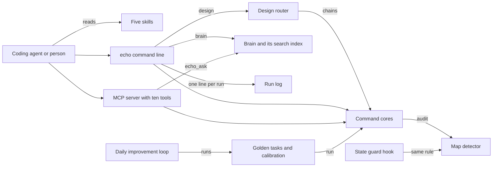

# How Echo works

Echo turns "add a rate limit" or "cache this" into correct, tested code for a serverless API. A rate limiter caps how often a caller may hit an endpoint. Echo picks the store, the algorithm, the key, the time to live and the failure mode. It refuses known traps, such as a `new Map()` counter that empties on every cold start. It is for coding agents first, through its command line and MCP server, and for people second, through a local page. MCP (Model Context Protocol) is a standard way for an agent to call tools.

## The parts



An agent reaches Echo in three ways. The [skills](../skills/) tell it when to act, for example before it stores state in an API route. The command line lives in [src/cli.ts](../src/cli.ts), with one file per command in [src/commands/](../src/commands/). The MCP server in [src/mcp-server.ts](../src/mcp-server.ts) offers ten tools over stdio. Both call the same command cores, so the answer is the same however an agent asks. The `design` command goes through [src/dispatch.ts](../src/dispatch.ts), which picks the cores a request needs and runs them in order.

[src/lib/map-detector.ts](../src/lib/map-detector.ts) holds Echo's main judgment. It tells a `new Map()` used as the source of truth apart from the one safe case, an `ephemeralCache` map. `echo audit` and the hook in [hooks/echo-state-guard.js](../hooks/echo-state-guard.js) both call it, so the rule lives in one place. [src/brain-index.ts](../src/brain-index.ts) searches the six expertise documents in [brain/](../brain/) with BM25, a standard keyword ranking. [src/observability.ts](../src/observability.ts) appends one line per command to a log in [logs/](../logs/). The evals live in [src/eval/](../src/eval/), and [workflows/rsi.workflow.js](../workflows/rsi.workflow.js) is the improvement loop.

## What happens when you run it

The main flow is `echo design "POST /checkout"`. From npx the command is `echo-cli`, because a shell runs its own `echo` first.

1. [src/cli.ts](../src/cli.ts) parses the command line. `instrument` in [src/observability.ts](../src/observability.ts) starts a timer for the run.
2. [src/commands/design.ts](../src/commands/design.ts) hands the endpoint to `runDesign` in [src/dispatch.ts](../src/dispatch.ts).
3. `planDesign` matches keywords and builds an ordered plan. The limiter comes first, then idempotency, then the cache, then the stampede defense. No model is called.
4. With `--json`, Echo prints the plan and stops there.
5. Otherwise each step runs its core. A checkout is a security endpoint and a write, so it gets a limiter and then idempotency.
6. [src/commands/limiter.ts](../src/commands/limiter.ts) prints a sliding-window limiter keyed on the signed-in identity. It fails closed, so it denies requests when the store is down.
7. [src/commands/idempotency.ts](../src/commands/idempotency.ts) prints the exactly-once pattern: an atomic claim, a request fingerprint and a 24-hour time to live.
8. Echo exits with the worst code of the steps. On exit, the run log gains one JSON line.

The second flow is `echo audit <path>`. [src/commands/audit.ts](../src/commands/audit.ts) scans the source files under a path with the map detector. It exits 1 and prints the file and line of each source-of-truth map. It exits 0 when the only map is an `ephemeralCache`.

## Extending it

- **A command.** Add a file in [src/commands/](../src/commands/) with a function that returns an exit code, like [src/commands/store.ts](../src/commands/store.ts). Register it in [src/cli.ts](../src/cli.ts) and add it to the command tree in [AGENTS.md](../AGENTS.md).
- **An MCP tool.** Add an entry to the `TOOLS` array in [src/mcp-server.ts](../src/mcp-server.ts). Each entry has a name, a description, a JSON Schema input and a handler that reuses a core. Add the name to `EXPECTED_TOOLS` in [test/mcp-contract.test.ts](../test/mcp-contract.test.ts).
- **A skill.** Add `skills/<name>/SKILL.md` with a `name` and a `description` in its front matter. Copy the shape of [skills/echo-state-audit/SKILL.md](../skills/echo-state-audit/SKILL.md).
- **An eval.** Add a task to `GOLDEN_TASKS` in [src/eval/golden/tasks.ts](../src/eval/golden/tasks.ts). Give it an id, a brain scenario, a level and an `assert` that runs a real core. Set `ciBlock: true` if it must block a merge. Labeled examples for the detectors go in [src/eval/lib/corpus.ts](../src/eval/lib/corpus.ts).
- **Expertise.** Add a section to one of the six documents in [brain/](../brain/), under a heading such as `## O-24`. The search index rebuilds itself when a document is newer than the index file.

Then run `pnpm build && pnpm test && pnpm eval`. CI in [.github/workflows/echo-ci.yml](../.github/workflows/echo-ci.yml) runs the same checks. It also runs the acceptance tests against a local Redis behind an Upstash-style REST server, as [SANDBOX.md](../SANDBOX.md) explains. A change that lowers an eval score is not merged.

## Questions

**Does it need an API key or cost money?**
The command line, the MCP server, the tests and the evals need no key and cost nothing. `echo doctor` only reports whether `UPSTASH_REDIS_REST_URL` and `UPSTASH_REDIS_REST_TOKEN` are set, never their values. If `ANTHROPIC_API_KEY` is set, `pnpm eval` also asks a Claude model to grade the trajectory tasks, which costs API credit. The code Echo writes for your app uses Upstash Redis, which bills per command. `echo cost` estimates that bill.

**Does any data leave the machine?**
Not from the command line or the MCP server, which work offline. With `ANTHROPIC_API_KEY` set, the eval sends Echo's own answers, up to 4,000 characters each, to the Anthropic API. The daily loop runs `npm view` to read the latest library version. Its link check lists the brain's links and fetches none. The local page from `pnpm cockpit` listens on 127.0.0.1 only.

**How does it improve itself?**
Its self-improvement contract, [dsip.json](../dsip.json), lists five levels: session, agent, user, org and fleet. It sets a nightly loop and `noSelfGrading: true`. [.github/workflows/rsi.yml](../.github/workflows/rsi.yml) runs [workflows/rsi.workflow.js](../workflows/rsi.workflow.js) every day at 09:17 UTC. The loop compares the pinned `@upstash/ratelimit` version with npm. It checks that the brain still marks its unverified figures, and it re-runs the evals. Drift becomes a proposal file, which the workflow uploads. The loop never edits the brain, and a person makes every change.

**How do I run its tests or checks?**

```bash
pnpm install && pnpm build
pnpm test                          # unit, contract and acceptance tests, with vitest
pnpm eval                          # golden tasks, each run three times, and detector calibration
pnpm run test:acceptance:limiter   # the limit holds under a concurrent burst
pnpm run test:acceptance:cache     # stale-while-revalidate and a jittered time to live
pnpm test:e2e                      # the local page, driven over HTTP
```

**What does it not do?**
It covers state at the HTTP edge only. It does not run background jobs or queues. It does not bill customers, and its idempotency pattern is not a payment ledger. It does not change your app by itself: it prints code for you or your agent to apply. It does not create an Upstash account or a Redis server.
